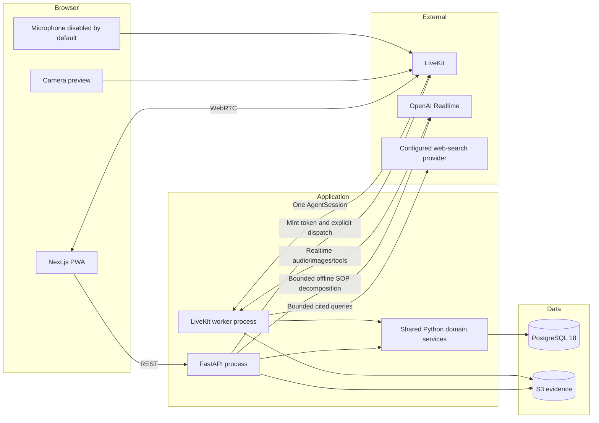

# 02 — Architecture

## 1. Design goals

In priority order:

1. Correct, server-authoritative SOP execution and evidence history.
2. Quiet, predictable assistant behavior.
3. Low conversational and visual-check latency.
4. A small number of deployables and dependencies.
5. Prototype visual and interaction parity.

The previous Memora implementation is not an architectural baseline. In particular, this design excludes its parallel perception/memory pipelines, large tool registry, recurring context work and proactive planner.

## 2. Repository layout

When implementation begins, move the current static app unchanged into `prototype/`, then generate the Better-T-Stack frontend at the repository root. `new-design/` is the extracted live-workspace redesign and remains a visual reference; it is not a production build target and must not be merged wholesale over the generated app.

```text
codex-hackathon/
├── apps/
│   ├── web/                         # Generated Next.js application
│   │   └── Dockerfile               # Bun build + standalone Node runtime
│   └── server/
│       ├── src/tara_server/
│       │   ├── api/                 # FastAPI routers and dependencies
│       │   ├── agent/               # LiveKit entrypoint, tools and speech modes
│       │   ├── domain/              # SOP, execution, reports and authorization services
│       │   ├── db/                  # SQLAlchemy models and repositories
│       │   ├── schemas.py           # Pydantic API/tool/SOP contracts
│       │   └── settings.py          # Typed environment configuration
│       ├── alembic/
│       ├── tests/
│       ├── pyproject.toml
│       └── Dockerfile
├── .railway/
│   └── railway.ts                   # Reviewed Railway project/environment IaC
├── docs/                            # This plan
├── new-design/                      # Extracted new visual design reference only
├── prototype/                       # Original HTML/CSS/JS, unchanged
├── .dockerignore
├── docker-compose.yml               # Local development/CI only
├── docker-compose.dev.yml
├── nx.json
├── package.json
└── pyproject.toml                   # Only if a uv workspace is actually needed
```

Do not create shared packages for one consumer. Generated FastAPI OpenAPI TypeScript types can live inside `apps/web`. Do not add an Nx Python plugin until root scripts alone are insufficient; `bun run` can invoke `uv run` directly.

### Better-T-Stack baseline

```bash
bun create better-t-stack@latest tara \
  --frontend next \
  --backend none \
  --runtime none \
  --api none \
  --auth none \
  --payments none \
  --database none \
  --orm none \
  --db-setup none \
  --package-manager bun \
  --no-git \
  --web-deploy docker \
  --server-deploy none \
  --no-install \
  --addons mcp nx pwa skills ultracite \
  --examples none
```

The generated TypeScript backend, ORM and auth options remain disabled because FastAPI owns those responsibilities. Pin the generated dependency lockfile after scaffolding rather than copying the different `saas-app` configuration.

## 3. Technology choices

| Layer | Choice | Reason and tradeoff |
| --- | --- | --- |
| Web | Next.js App Router, React, TypeScript, Tailwind, PWA | Matches the requested scaffold and supports server-rendered queue/report pages plus a realtime client workspace |
| Monorepo | Bun workspaces + Nx | Reuses the requested tooling; avoid extra package boundaries |
| Web quality | Ultracite/Biome | One formatter/linter for TypeScript |
| API | FastAPI + Pydantic | Typed REST/OpenAPI contracts and straightforward async dependencies |
| Persistence | SQLAlchemy Async + asyncpg + Alembic | Shared async repositories and explicit migrations on PostgreSQL 18 |
| Realtime | LiveKit Agents Python `~=1.8`, locked exactly | Managed WebRTC/media lifecycle and direct OpenAI Realtime support |
| Model | GPT Realtime 2.1 target through the direct OpenAI plugin | Native audio and video/tool support; exact direct-plugin model ID/account access is validated in the spike |
| Evidence | S3-compatible object storage | Keeps large/binary evidence out of Postgres and supports signed access |
| Search | PostgreSQL full-text search | Grounded SOP retrieval without another service or per-turn document embeddings |
| Python quality | uv, Ruff, mypy, pytest | Small, reproducible Python tooling baseline |
| Browser testing | Playwright | End-to-end execution, permission and accessibility journeys |

No separate STT, LLM or TTS providers are needed for the realtime conversation. A structured-output text model may be used for offline SOP decomposition; it is not another live agent.

## 4. Runtime topology



## 5. Process responsibilities

### Next.js

- Render authenticated queue, SOP, report and evaluation pages.
- Start/resume runs through FastAPI.
- Connect to LiveKit with the returned short-lived token.
- Display continuous local/remote camera preview without implying continuous AI analysis.
- Keep normal microphone conversation disabled until **Ask TARa** is activated.
- Send activation/deactivation and text input through LiveKit.
- Render authoritative run snapshots and alerts received over the data channel.
- Refetch the server snapshot after reconnect.

### FastAPI

- Username/password JWT authentication and role dependencies.
- Work-order assignment and organization scoping.
- SOP import, decomposition, editing, publication and retrieval APIs.
- Run creation/resume and non-realtime actions.
- Report generation, review, export and evaluation queries.
- LiveKit room naming, short-lived token minting and explicit dispatch.
- Evidence metadata and signed download endpoints.

### LiveKit worker

- Accept only explicitly dispatched jobs.
- Load the run and pinned SOP using opaque dispatch metadata.
- Own the OpenAI Realtime `AgentSession` and interaction mode.
- Keep normal audio input disabled in silent mode.
- Trigger proactive speech only for eligible recorded alerts.
- Execute a small allowlisted set of function tools through shared services.
- Capture bounded visual evidence and publish browser updates.
- Record final consultation transcripts, tool calls, model usage and realtime failures.
- Close owned tasks, streams and sessions cleanly.

### Shared domain services

- Authorize the actor and run.
- Validate SOP definitions.
- Load the current execution context.
- Apply transitions transactionally.
- Create attempts, evidence, issues, escalations and audit events.
- Build reports and evaluation projections.

The worker calls these services directly. It must not make an internal HTTP request back to FastAPI for every tool.

## 6. Run creation and connection sequence

1. Browser calls `POST /api/v1/work-orders/{id}/runs`.
2. FastAPI validates the JWT and technician assignment.
3. FastAPI returns the existing resumable run or creates one pinned to the work order’s published SOP version.
4. FastAPI generates an opaque room/identity, creates explicit agent dispatch with only the run ID as metadata, and returns a short-lived room-scoped LiveKit token.
5. The browser joins with camera available and microphone conversation disabled.
6. The worker loads the run, confirms it is executable, initializes one realtime session in silent mode and subscribes to the relevant participant.
7. The worker emits a `run.snapshot`; subsequent changes are events plus a fresh authoritative snapshot when needed.
8. If dispatch fails, FastAPI returns an error/retryable state rather than a seemingly usable connection.

A reconnect creates a new realtime connection with a compact current-run summary. It does not replay the entire previous chat history into the model.

## 7. State ownership

| State | Authority |
| --- | --- |
| Current SOP version, step and attempt | PostgreSQL execution service |
| Legal transition and completion | PostgreSQL transaction/domain validation |
| Accepted/rejected evidence | Object storage + Postgres metadata |
| Speech interaction mode | Worker, mirrored to browser |
| LiveKit connection/media state | LiveKit + browser/worker |
| Draft checklist while disconnected | Browser display only; never authoritative |
| Reports and reviews | PostgreSQL immutable snapshots/revisions |

The browser never advances a checkmark solely because a model said “done.” It renders the committed server result.

## 8. Evidence storage

- Store source SOP documents and accepted/rejected verification frames as objects.
- Store object key, SHA-256 hash, media type, dimensions, timestamps and run/step/attempt linkage in Postgres.
- Use short-lived signed URLs for authorized viewing.
- Keep large base64 images out of JSON events, database rows and LiveKit messages.
- Do not store continuous audio/video by default.

## 9. Failure boundaries

| Failure | Required behavior |
| --- | --- |
| LiveKit disconnected | Keep current instruction visible, show reconnecting state, disable new completion until server snapshot returns |
| Worker unavailable | Queue/report APIs remain usable; live AI features show unavailable rather than simulated success |
| OpenAI unavailable | Preserve run state and visible instructions; show controlled alert for a blocked required check |
| Tool timeout | Record failure, do not advance, allow retry or escalation |
| Evidence upload fails after model assessment | Do not mark the step passed; record the failure and request another attempt |
| Browser refresh | Rejoin the same run and pinned SOP version without replaying duplicate actions |
| API restart | No in-memory business state is lost; active worker/reconnect restores from Postgres |

## 10. Deliberate simplicity tradeoffs

- **One Python project:** easier shared transactions and fewer packages, with some API/worker dependency coupling. Split only when measured needs justify it.
- **Relational current state + audit events:** easier queries than event replay, while retaining complete history.
- **Full-text retrieval first:** less semantic flexibility than vectors, but fewer calls and less infrastructure.
- **Online PWA:** installability and reconnect without pretending unsafe offline AI completion is possible.
- **No queue in v1:** offline SOP decomposition is a bounded request for limited documents. Add a real job system only for demonstrated volume/size requirements.
- **No microservices:** API and worker are separate processes because media lifecycle requires it, not because every domain needs its own service.
