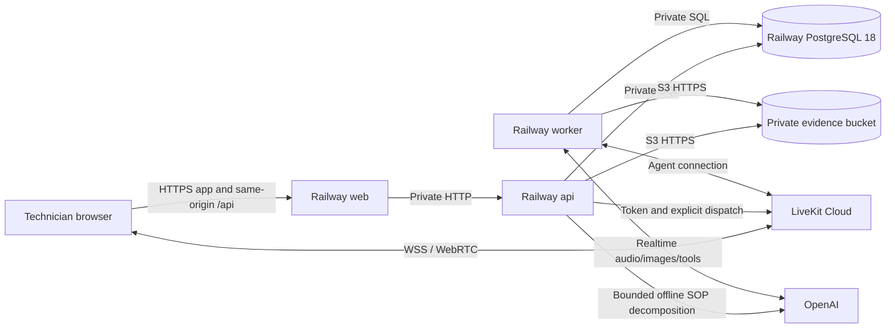

# 11 — Railway deployment plan

**Status:** Proposed; no Railway resources have been created or changed  
**Target:** one Railway project with isolated `staging` and `production` environments  
**Scope:** deployment, release operations and recovery for the architecture in [02](02-architecture.md)

## 1. Deployment decision

Deploy TARa to Railway as three application services plus PostgreSQL and private S3-compatible object storage:

| Railway resource | Purpose | Public exposure |
| --- | --- | --- |
| `web` | Next.js PWA and same-origin `/api` reverse proxy | One HTTPS application domain |
| `api` | FastAPI, authentication, domain APIs, migrations and LiveKit dispatch | Private Railway networking only |
| `worker` | LiveKit Agents process using the direct OpenAI Realtime plugin | No inbound public domain; outbound LiveKit/OpenAI connections |
| `postgres` | PostgreSQL 18, pinned to the major version | Private Railway networking only |
| `evidence` | Private bucket for source documents and selected evidence | Authenticated S3 endpoint; no public objects |

LiveKit Cloud and OpenAI remain external providers. Do not self-host LiveKit, MinIO, Redis, Neo4j or another database on Railway.

Start with one replica of each application service in one region. Disable application sleeping for `web`, `api` and especially `worker`: a sleeping worker cannot accept an explicit dispatch promptly. Add replicas, HA, multi-region deployment and PR environments only when measured operating needs justify them.

### Important platform choices

- Use **`.railway/railway.ts` Infrastructure as Code (IaC)** for the whole Railway environment.
- Do **not** create new `railway.json` or `railway.toml` files. Railway's legacy Config as Code is deprecated, new services cannot opt into it, and legacy files stop being read on **2026-12-01**.
- Use GitHub-connected services and Dockerfiles for normal deployments. `railway up` is a manual/emergency path, not the primary release mechanism.
- Keep Compose for local development and CI image verification only. Railway does not need or consume the Compose file.

## 2. What to reuse from Memora—and what not to copy

The separate `/home/pongo/projects/ristek/memora-hihi` project provides useful operational evidence, not a domain architecture to import.

| Memora evidence | Useful lesson for TARa | TARa decision |
| --- | --- | --- |
| Root-context `apps/backend/Dockerfile` | A monorepo image can use `uv sync --locked`, staged builds and a small runtime | Reuse the pattern with one Python project and none of Memora's CV/Torch/model-weight downloads |
| Backend and worker Compose services | API and LiveKit worker must be separate processes; both can use the same server source/image | Same Python image revision, different Railway services and start commands |
| Dashboard standalone Dockerfile | Build with Bun, run Next standalone with Node, copy `.next/static` | Reuse, but also copy `public/` so the PWA manifest, icons and service worker are present |
| Frozen Bun/uv lockfiles and `.dockerignore` | Reproducible, smaller builds and no local secrets/artifacts in images | Retain |
| `railway.json` versus `railway.worker.json` | Sharing one service config made the worker accidentally run Uvicorn | Keep explicit per-service start commands in one project-level IaC file; verify the running worker command |
| Stale `preDeployCommand` incident | An omitted legacy field can retain dashboard state; a failed pre-deploy prevents the app container from starting | Use IaC plan/read-back, API-only migration pre-deploy, bounded timeout and pre-deploy logs; do not copy legacy empty-array workarounds blindly |
| Empty deploy logs and stderr severity note | Pre-deploy failure and log formatting can obscure the actual failure | Log structured levels to stdout, reserve stderr for errors, and inspect pre-deploy/build/runtime logs separately |
| Compose PostgreSQL health/volume patterns | Local dependencies need health checks and persistent data | Retain PostgreSQL 18 and add MinIO; omit Neo4j and all unrelated services |

Memora's `railway.json` files are historical references only. Copying them would create a new deployment on a configuration system approaching its hard cutoff.

## 3. Target topology



Railway Buckets currently use public networking for S3 access even from Railway services. The bucket remains private and requires credentials; object keys are not publicly listed and downloads use authorized, short-lived presigned URLs. Do not describe this traffic as private networking.

### Region

Choose the initial region from technician location, LiveKit media latency and OpenAI measurements. Place application services and PostgreSQL in the same Railway region and select the geographically corresponding bucket region using the bucket's own supported region identifiers.

Bucket regions are immutable after creation. Region selection is therefore a provisioning gate, not a setting to change casually later. Do not assume a multi-region active/active design: PostgreSQL and authoritative run state remain single-region in v1.

## 4. Environments and isolation

Use one Railway project named `tara`, with `staging` and `production` environments.

| Concern | Staging | Production |
| --- | --- | --- |
| Git branch | `develop` or the chosen integration branch | `main`, with release approval |
| Application replicas | One each | One each initially |
| PostgreSQL/bucket | Environment-local empty/test data | Environment-local real data; never copied wholesale to staging |
| LiveKit | Separate credentials, rooms and agent name; separate Cloud project preferred | Separate credentials, rooms and agent name |
| OpenAI/search | Separate keys and usage budget | Separate keys and production budget/alerts |
| Demo seed | Allowed with clearly non-production credentials | Never; create only the initial organization/users through a one-time controlled command |
| Sleep | Disabled for realistic realtime tests | Disabled |
| PR environments | Deferred | Not applicable |

Each Railway environment receives isolated bucket instances and credentials. Sealed variables are not copied when duplicating an environment, so provision secrets independently rather than assuming environment duplication is sufficient.

## 5. Planned repository deployment files

These are implementation deliverables, not files claimed to exist now:

```text
.railway/
├── railway.ts                  # One definition of all Railway resources
└── README.md                   # Generated/maintained plan-apply instructions
apps/
├── web/
│   ├── Dockerfile
│   └── next.config.ts          # standalone output + /api private rewrite
└── server/
    ├── Dockerfile
    ├── pyproject.toml
    └── uv.lock
.dockerignore
docker-compose.yml              # Local/CI only
docker-compose.dev.yml          # Optional local overrides only
.env.example                    # Names/placeholders only, never secrets
```

Keep the full repository as the Docker build context for all three application services. Do not set restrictive service root directories that hide root Bun/uv lockfiles or shared workspace configuration. Use the explicit Dockerfile paths and watch patterns instead.

The TypeScript IaC package must be installed and locked with the Bun dependencies. After every IaC change, run `railway config plan`; no infrastructure apply is implied by editing or committing the file.

## 6. Railway service configuration

The following module paths are implementation contracts to create during scaffolding.

| Setting | `web` | `api` | `worker` |
| --- | --- | --- | --- |
| Dockerfile | `apps/web/Dockerfile` | `apps/server/Dockerfile` | `apps/server/Dockerfile` |
| Start command | `node apps/web/server.js` | `sh -c 'exec uvicorn tara_server.api.main:app --host 0.0.0.0 --port "${PORT:-8000}"'` | `python -m tara_server.agent.worker start` |
| Pre-deploy | None | `cd apps/server && alembic upgrade head` | None |
| Deploy healthcheck | `/health` | `/api/v1/health/ready` | No invented HTTP endpoint; verify process and real dispatch |
| Restart | On failure, bounded retries | On failure, bounded retries | On failure, bounded retries; fatal worker errors exit non-zero |
| Replicas | 1 | 1 | 1 initially |
| Public domain | Application domain | None | None |

Validate the actual Next standalone output path during the first build; monorepo output can place `server.js` according to the app directory and tracing root. Do not keep the command above if the generated artifact proves a different path.

Set an initial pre-deploy timeout of **300 seconds**, with room to adjust from measured migration duration. Also configure bounded database connect/lock behavior in the migration settings. Railway's default pre-deploy behavior has no time limit, which can leave a release waiting indefinitely. A timeout or non-zero exit must fail the deployment and leave the previous application version running.

### Watch patterns

- `web`: `apps/web/**`, root `package.json`, `bun.lock`, `nx.json` and shared frontend files if any are later introduced.
- `api` and `worker`: `apps/server/**`, plus root Python workspace manifests only if a uv workspace is actually used.
- Keep API and worker on the same server watch set so a domain/schema change cannot deploy one without the other.
- Do not rebuild production images for changes limited to `docs/**`, `prototype/**` or `new-design/**`.

### IaC ownership rules

- Declare every Railway resource in the single `.railway/railway.ts`; omitting a managed resource can plan its deletion.
- Do not commit Railway UUIDs, generated service domains or secret values. Use resource references and `preserve()` for imported secrets.
- Do not manage a service with both legacy Config as Code and IaC.
- Review `railway config plan` for every change. A human must explicitly approve an apply, and any destructive apply requires separate explicit approval.
- After apply, read back service/configuration state and confirm that API runs migrations, worker runs the LiveKit entrypoint, and web/worker have no migration command.
- Remember that Railway does not read `.railway/railway.ts` during an ordinary application deployment. IaC plan/apply is a separate reviewed configuration workflow.

## 7. Networking, domains and cookies

### Public application origin

Expose only `web`, for example `app.example.com`. The browser calls relative `/api/v1/...` paths. Next.js rewrites those requests to:

```text
API_PROXY_ORIGIN=http://${{api.RAILWAY_PRIVATE_DOMAIN}}:8000
```

This proxy runs on the Next.js server, not in the browser, so private Railway networking is valid. It also preserves the existing same-origin HttpOnly cookie design and avoids production CORS. FastAPI still validates `Origin` for cookie-authenticated mutations against the external application origin.

`API_PROXY_ORIGIN` and `NEXT_PUBLIC_LIVEKIT_URL` are non-secret Docker **build arguments** because Next rewrites/public browser configuration can be baked into the standalone build. Declare only those `ARG`s in the web build stage. Never pass JWT, database, LiveKit-secret, OpenAI or S3-secret values as web build arguments or `NEXT_PUBLIC_*` variables.

The browser connects directly to the configured HTTPS/WSS LiveKit Cloud URL. API and worker require outbound network access; neither needs an inbound public Railway domain.

PostgreSQL has no permanent TCP proxy/public endpoint. Local development uses Compose PostgreSQL, not the production database. Temporary administrative access must be deliberate and removed afterward.

If host-header restrictions are enabled, permit Railway's `healthcheck.railway.app` healthcheck hostname while retaining the intended application host rules.

## 8. Container build plan

### Web image

1. Use a pinned Bun build image and the repository root as context.
2. Copy the root/workspace manifests and `bun.lock`; run `bun install --frozen-lockfile`.
3. Copy the web source and required workspace configuration.
4. Configure Next `output: "standalone"` and the correct monorepo output tracing root.
5. Declare only non-secret build arguments, then run the production build with telemetry disabled.
6. Use a pinned, minimal Node runtime compatible with the generated Next version.
7. Copy `.next/standalone`, `.next/static` **and `public/`** to their verified standalone paths.
8. Run as a non-root user with `HOSTNAME=0.0.0.0`; honor Railway's `PORT`.

The `public/` copy is a release requirement because a standalone build without it can silently lose the PWA service worker/manifest/icons.

### API/worker image

1. Use a pinned Python 3.12 + uv builder and `uv sync --locked --no-dev` with cached dependency layers.
2. Install only the `apps/server` project and its runtime dependencies.
3. Copy source, Alembic configuration/migrations and the built virtual environment into a small Python runtime.
4. Run as a non-root user with unbuffered output and no runtime package installation or model downloads.
5. Use the API Uvicorn command by default; override only the start command for the worker service.
6. Keep `sh -c 'exec ...'` only where shell expansion of `PORT` is needed so the final process receives signals correctly.

Both services must use the same source revision and locked dependency resolution. Railway may build two images rather than share one image digest; that is acceptable initially. Publishing one immutable image to GHCR is an optional later optimization, not new v1 infrastructure.

### `.dockerignore`

Exclude `.git`, environment files, `node_modules`, `.next`, `.venv`, Python/Nx/test caches, logs and local artifacts. Allow only `.env.example`. Do not exclude migration files, PWA public assets or lockfiles required by the builds.

### Compose

Keep local services limited to `web`, `api`, `worker`, `postgres:18` and `minio`, with health checks and persistent local volumes. Run migrations as an explicit one-shot command before dependent tests, not independently in API and worker startup. Compose builds must use the same Dockerfiles and root context as Railway.

Production environment variables, external LiveKit/OpenAI credentials and Railway bucket behavior must not be replaced by fake success in Compose. Provider-free unit/integration tests use explicit fakes; a realtime smoke test requires real credentials.

## 9. Variables and secret boundaries

Use typed startup validation. Missing required values stop the affected service before it appears ready. Use Railway references rather than copying generated values into source.

| Variable/group | `web` | `api` | `worker` | Notes |
| --- | --- | --- | --- | --- |
| `PORT` | Railway-provided | Railway-provided/default 8000 | Only if a verified worker HTTP server is enabled | Web/API must listen on it |
| `APP_ORIGIN` | — | External HTTPS web origin | — | Secure cookie/origin validation |
| `API_PROXY_ORIGIN` | Build argument | — | — | API private domain, non-secret |
| `NEXT_PUBLIC_LIVEKIT_URL` | Build argument/public value | — | — | WSS URL, never an API secret |
| `DATABASE_URL` | — | PostgreSQL reference | Same reference | Private database URL; normalize to SQLAlchemy asyncpg in typed settings |
| `JWT_SECRET`, issuer/TTL | — | Runtime sealed secret/config | — | Never needed by worker or web |
| `LIVEKIT_URL/API_KEY/API_SECRET` | Public URL only | Runtime sealed credentials | Runtime sealed credentials | Different credentials per environment |
| `LIVEKIT_AGENT_NAME` | — | Same environment value | Same environment value | Explicit dispatch target; distinct staging/production names |
| `OPENAI_API_KEY`, realtime model | — | — | Runtime sealed secret/config | Realtime only |
| `SOP_OPENAI_API_KEY`, SOP text model | — | Runtime sealed secret/config | — | Offline decomposition only; keeps the realtime credential out of API |
| Web-search provider/key | — | — | Runtime sealed secret/config | Only if consultation web search is enabled |
| `S3_ENDPOINT/BUCKET/REGION` | — | Bucket references | Same references | Use the globally unique `BUCKET`, not its display name |
| `S3_ACCESS_KEY_ID/SECRET_ACCESS_KEY` | — | Bucket references/sealed values | Same references/sealed values | No browser access to these credentials |
| Logging/model/feature configuration | Minimal public config | Runtime config | Runtime config | No secrets in literals committed to IaC |

Use virtual-hosted S3 URLs by default. Older Railway buckets may require path-style access; follow the bucket Credentials tab rather than hardcoding the wrong style.

Secret rotation changes runtime variables only and triggers a controlled redeploy. Do not rebuild the web image to rotate backend secrets. Never print variable values in plans, CI logs, application logs or runbooks.

## 10. Health and readiness contract

Railway healthchecks gate deployment traffic switching; they are not continuous monitoring. Implement three different checks rather than one dependency-heavy endpoint.

| Check | Behavior |
| --- | --- |
| Web `GET /health` | Next process can serve requests; return minimal status without depending on API/database |
| API `GET /api/v1/health/live` | Process/event loop is running; no external dependency requirement |
| API `GET /api/v1/health/ready` | Migrations are at the expected head, PostgreSQL responds to `SELECT 1`, and the evidence bucket/credentials support a bounded metadata check |

Do not include OpenAI availability or worker registration in the API Railway healthcheck. Otherwise an AI outage could take down the useful queue/report API, and initial API/worker deployment order could become circular.

A successful Railway deployment is not proof of realtime readiness. The release smoke test must separately:

1. Confirm the worker process command and LiveKit registration.
2. Create an authorized test run/room and explicit dispatch.
3. Observe session-ready without a greeting.
4. Complete one activated audio turn and one silent visual/tool path.
5. Verify one alert path, evidence object, database audit row and signed download.
6. Delete or mark test data according to the environment's test-data policy.

Use an external uptime monitor for the public web/application API and scheduled synthetic realtime checks for worker/provider availability. Keep health responses minimal; detailed dependency errors belong in redacted logs.

## 11. Database migration and release safety

Alembic runs **once per API deployment** through the API pre-deploy command. It must not run in web/worker startup or once per Uvicorn worker/replica.

Release rules:

1. CI upgrades an empty PostgreSQL 18 database and a copy of the previous schema, checks migration drift and tests the new code against the migrated schema.
2. Before production, back up PostgreSQL and verify that the latest restore test is current.
3. Keep migrations backward-compatible with both old and new web/API/worker code during a rolling release.
4. Prefer expand → deploy → contract over separate releases. Never combine a destructive schema contraction with the first code release that depends on it.
5. Run `alembic upgrade head`, then verify `alembic current` and the expected revision. Non-zero/timeout blocks deployment.
6. Do not seed users or demo data in every pre-deploy run. Initial owner/organization seeding is an idempotent, one-time administrative action.
7. Do not automatically downgrade the database during application rollback. Roll forward or perform a separately reviewed restore/maintenance operation.

Inspect pre-deploy logs when deployment fails before the application container starts. Empty runtime logs are not evidence that the application image is healthy or that no migration ran.

Large blocking migrations require a maintenance plan rather than a longer timeout. PostgreSQL HA/backup features do not make an unsafe migration non-blocking.

## 12. Worker rollout and active sessions

Web/API state can be restored from PostgreSQL, but active realtime sessions belong to worker processes. A normal container restart is not automatically a zero-interruption realtime deploy.

Implement and test this lifecycle:

- On SIGTERM, stop accepting new agent jobs, stop creating new OpenAI sessions, retain session-finalization writes, and allow active jobs to drain.
- Keep old/new RPC and run-snapshot contracts compatible during overlap. Both worker versions may temporarily use the same environment-specific agent name.
- Configure Railway overlap/draining deliberately. Start with a **300-second pilot drain limit**, then tune from measured session duration and Railway limits.
- If the drain deadline expires, the browser must reconnect silently, reauthorize, reload the authoritative run and discard stale frames/attempts. Never claim zero interruption unless a longer drain or explicit session migration has been proven.
- Verify that rollback/redeploy does not leave a service running Uvicorn under the `worker` name, as happened in the Memora reference project.

Scale worker capacity from concurrent-session soak tests, event-loop lag, CPU/memory and dispatch-to-ready p95. Start vertically, then add worker replicas with the same agent name when jobs are stateless across dispatches and database idempotency tests pass. Do not add sticky browser-to-worker infrastructure: one dispatched job is owned by its assigned worker, and reconnect creates a fresh authorized dispatch.

## 13. CI/CD and promotion

### Pull requests

Run the existing quality/test matrix, build both Docker images, and validate Compose startup. When `.railway/**` changes, run `railway config plan` with an environment-scoped token and publish the redacted plan for review. Fork pull requests receive no Railway secrets.

### Staging

1. Apply a reviewed staging IaC plan only when infrastructure configuration changed.
2. Deploy the same integration commit to web/API/worker through GitHub-connected services.
3. API pre-deploy migrates the staging PostgreSQL 18 database.
4. Wait for terminal deployment status and healthchecks.
5. Run browser, API, migration, evidence and real-provider realtime smoke tests.
6. Do not report success from a queued build or a healthy web response alone.

### Production promotion

1. Select the exact commit that passed staging; do not rebuild from an untested branch tip.
2. Review the production diff, migration plan, backup status and any `.railway` plan.
3. Require the configured GitHub/Railway deployment approval.
4. Deploy web/API/worker from that commit and wait for every service to reach `SUCCESS`.
5. Run the full release smoke, including explicit dispatch, silent behavior, evidence and reconnect.
6. Monitor deploy/worker restarts, API errors, dispatch-to-ready and active runs before closing the release.

Use `railway deployment list --json` or the corresponding dashboard status to observe terminal states. `railway up --detach` means queued, not deployed. Normal releases should use the GitHub integration; any manual `railway up` must name the project/environment/service and release summary explicitly.

## 14. Backup, restore and rollback

### PostgreSQL

- Enable production backups; choose PITR/HA only from agreed recovery objectives and budget.
- Record the database major, Alembic revision and release SHA with recovery checks.
- Restore into a separate clean PostgreSQL 18 service and verify organization isolation, current runs, report queries and migration state before relying on the backup.
- A single-node database with backups is not automatic failover. Do not claim HA until it is actually enabled and tested.

### Evidence bucket

Railway Buckets currently provide private S3 storage and presigned URLs, but **no automatic backups/snapshots, object versioning, object locks or bucket lifecycle configuration**. They are encrypted at rest, but configurable S3 server-side encryption is listed as unsupported.

Therefore:

- Use a Railway private bucket for initial staging/pilot simplicity, write-once generated keys, SHA-256 metadata and application-controlled retention.
- Do not claim immutable/WORM evidence or automated lifecycle deletion from this bucket alone.
- Define an independent evidence export/restore procedure before production reliance; PostgreSQL backups do not contain evidence objects.
- If contractual retention, versioning, object lock or automated lifecycle controls are required, use an external S3-compatible provider with those controls instead of forcing Railway Buckets to fit.
- Test restored database object keys, hashes and authorized presigned downloads together. A database-only restore is not a complete TARa recovery test.

### Application rollback

1. Stop promotion and identify the last known-good web/API/worker release SHA.
2. Redeploy all three compatible application services from that release; never roll back only the UI when API/RPC contracts changed.
3. Preserve the database and evidence; do not run automatic downgrades or delete new audit rows.
4. Let active workers drain/reconnect using the tested path.
5. Run smoke tests and inspect errors. If old code cannot read the new schema, roll forward or invoke the reviewed database recovery plan instead.

Define numeric RPO/RTO before broader production use. Until then, recovery capability is explicitly unproven rather than implied by enabling backups.

## 15. Logs, metrics and operational alerts

Use Railway built-in deployment logs and resource metrics initially; do not add Prometheus/Grafana to the first deployment.

- Emit structured JSON logs to stdout with timestamp, level, service, environment, release SHA and correlation IDs.
- Include run/step/attempt IDs where authorized, but exclude passwords, JWTs, provider keys, signed URL query strings and unnecessary transcript content.
- Keep business audit history in PostgreSQL; Railway logs are not the audit store.
- Alert on failed deployments/pre-deploys, repeated restarts, public health failures, database capacity/connection failures, worker registration/dispatch failures, event-loop lag and realtime provider error rates.
- Track active sessions, concurrency, dispatch-to-ready and memory/CPU to choose worker capacity from evidence.
- Add continuous synthetic realtime monitoring because Railway healthchecks run during deployment, not continuously.

## 16. First-deployment runbook

1. **Confirm inputs:** GitHub repository, Railway workspace/project access, production/staging region, custom domain/DNS owner, LiveKit Cloud credentials, OpenAI access, search-provider decision, expected pilot concurrency and retention/RPO/RTO requirements.
2. **Verify artifacts:** local tests and PostgreSQL 18 integration tests pass; both Docker images build; standalone web contains static/public PWA assets; API and worker commands start the intended processes.
3. **Author IaC:** declare web/API/worker/PostgreSQL 18/bucket in `.railway/railway.ts`; run and review `railway config plan`. Do not apply an unreviewed or destructive plan.
4. **Provision data services:** verify `SHOW server_version` reports PostgreSQL 18.x and create the bucket in the selected immutable region. Keep PostgreSQL private.
5. **Set variables:** use environment-scoped sealed secrets and Railway references. Confirm only public/non-secret values are declared as web Docker build arguments.
6. **Connect sources/domains:** point each application service at the same repository/branch and correct Dockerfile; attach the custom domain only to web.
7. **Deploy foundation:** deploy API so its bounded pre-deploy migrates the database, then worker and web from the same commit. Wait for terminal statuses and API/web healthchecks.
8. **Seed once:** create the initial organization and users with a controlled one-time administrative command inside the private service environment. Never use demo passwords in production.
9. **Run release smoke:** login/RBAC, SOP import, evidence upload/download, explicit worker dispatch, no greeting, activated consultation, one silent check, one corrective alert and reconnect.
10. **Enable monitoring and record:** capture deployment IDs, release SHA, Alembic revision, bucket/database region, recovery status and any accepted limitations.

## 17. Deployment acceptance gates

A Railway environment is not considered ready until all applicable checks pass:

- [ ] IaC plan is reviewed, applied intentionally and read back with no dual legacy configuration ownership.
- [ ] `web`, `api`, `worker`, PostgreSQL and bucket are in the intended environment/region; production/staging secrets and data are isolated.
- [ ] PostgreSQL reports 18.x; no public database proxy is permanently exposed.
- [ ] Web is the only public application domain; same-origin `/api` reaches private FastAPI and secure cookies/origin checks work.
- [ ] API runs Alembic once in pre-deploy with a tested timeout; web/worker never migrate on startup.
- [ ] Worker is demonstrably running the LiveKit entrypoint, not Uvicorn, and accepts only explicit authorized dispatch.
- [ ] Standalone web serves `.next/static`, manifest, icons and service worker; no secret is present in public environment variables or image history.
- [ ] API/web healthchecks pass, while provider/worker outages do not unnecessarily take down queue/report APIs.
- [ ] Realtime release smoke passes silent/alert/consultation behavior and exact evidence/audit persistence.
- [ ] SIGTERM drain and forced-deadline reconnect have both been tested.
- [ ] A previous application release can be redeployed without an automatic database downgrade.
- [ ] PostgreSQL restore and evidence recovery have been exercised; unsupported bucket guarantees are documented.
- [ ] Logs contain useful correlation without secrets; queued/building deployments are never reported as successful.

## 18. Deliberate deferrals and remaining inputs

Deferred for the initial Railway deployment:

- Kubernetes, Terraform/Pulumi and a second infrastructure control plane.
- PR environments with paid external-provider credentials.
- Multi-region active/active execution and automatic cross-region failover.
- Self-hosted LiveKit, Redis/Celery, Neo4j, vector databases and separate observability stacks.
- GHCR image-promotion pipeline unless duplicate Railway builds become a measured problem.
- Automatic horizontal scaling before concurrency/soak measurements exist.

Still required before production provisioning:

1. Pilot/user location and selected Railway/bucket region.
2. Custom domain and DNS ownership.
3. Railway plan/resource limits, PostgreSQL backup/HA choice and budget.
4. LiveKit Cloud environment isolation and OpenAI/search credentials/budgets.
5. Expected concurrent active runs and worker drain target.
6. Evidence retention, immutable-storage requirements, independent backup method and numeric RPO/RTO.

These inputs affect configuration and recovery guarantees; they do not justify new application subsystems by themselves.
