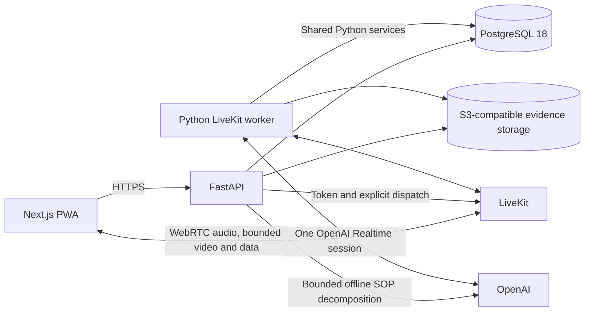

# Executive summary

## Product

TARa guides technicians through approved SOPs and produces an evidence-backed record of what happened. The existing prototype already establishes the core experience: a work queue, a voice/video execution workspace, automatic evidence checks, attestations, deviations, escalations and supervisor-readable reports.

The production system should preserve that interaction contract while replacing scripted behavior with four real capabilities:

1. **Controlled SOP publishing** — upload Markdown/TXT/text-PDF, generate a detailed draft breakdown, review it and publish an immutable version.
2. **Checked execution** — a deterministic state machine tracks every step and attempt; the AI cannot skip prerequisites or invent a transition.
3. **Restrained realtime assistance** — the agent stays quiet during correct work, speaks proactively for detected problems, and answers normal questions only after **Ask TARa** is activated.
4. **Audit and evaluation** — accepted and rejected evidence, mistakes, choices, tool calls, exceptions, timings and reviews are retained for owners and supervisors.

## Design reference

The redesigned live workspace is extracted at [`new-design/`](../new-design/) from `new-design.zip`. It is a **visual design change only**: layout, hierarchy, typography, glass treatment and state styling. It does not add or change SOP behavior, agent capabilities, tools, evidence rules, reports, permissions or backend requirements.

Its prototype controls—including the manual state selector and Sleep/Pause presentation—are demonstration affordances, not approved product behavior. Functional requirements remain authoritative. See [10 — New design reference](10-new-design.md).

## Recommended system

The smallest useful deployment has three application components:

- **Next.js** for the queue, SOP management, live execution, reports and evaluation.
- **FastAPI** for authentication, work orders, SOPs, runs, reports, LiveKit tokens and explicit agent dispatch.
- **Python LiveKit worker** for one OpenAI Realtime session per active run and a small set of validated tools.

FastAPI and the worker start as two commands from one Python project so they share domain services without internal HTTP hops. PostgreSQL is the only required database. S3-compatible storage holds evidence frames; MinIO is used only in local development.

The deployment target is Railway: private FastAPI/worker services, a public Next.js origin with a same-origin private API proxy, PostgreSQL 18 and environment-isolated object storage, all managed through reviewed TypeScript IaC. See [11 — Railway deployment](11-railway-deployment.md) for the configuration, rollout and recovery plan, including Railway Bucket limitations.

## Interaction model

| Situation | Agent behavior | UI behavior |
| --- | --- | --- |
| Correct visual check or attestation | No speech | Check the step, show the next instruction and preserve evidence |
| Routine step transition | No greeting or narration | Update progress, current clause and checklist |
| Failed criterion, wrong choice or unsafe request | Short proactive correction | Show the failed criterion, alert and allowed recovery |
| Repeated unchanged failure | Do not nag on every frame | Keep the alert visible; speak again only after a new attempt or changed condition |
| Technician needs help while doing correctly | Silent until **Ask TARa** is clicked | Enable voice/text consultation and show its active state |
| Consultation ends | Return to silent execution | Disable normal microphone conversation and non-alert speech |
| Muted | No audio, including alerts | Keep every alert and correction visible |

Proactive detection occurs at checks and recorded events, not through continuous evaluation of every movement. This is an intentional latency, cost and noise boundary.

## SOP and RAG decision

AI decomposition happens **offline**, before execution. It produces schema-validated steps with instructions, rationale, source citations, evidence criteria and failure behavior. A SOP manager must edit and publish the result. Runs pin the published version forever.

Use RAG only for questions such as “what does a keycap look like?”, “why does this step matter?” and “show the relevant clause.” The current step and its legal transitions come directly from database IDs and execution state.

Start with PostgreSQL full-text search over published, heading-aware chunks. It provides grounded retrieval without a separate vector service or an embedding request on every turn. Add pgvector only if a measured question set proves lexical retrieval inadequate.

## AI and latency decision

Use the direct OpenAI plugin for LiveKit Agents. Current LiveKit documentation states that realtime video requires this plugin; LiveKit Inference does not support image/video input for realtime models.

The agent has:

- one native speech-to-speech session;
- no separate STT/LLM/TTS chain;
- no subagents, handoffs, planner or memory pipeline;
- no separate continuous scene analyzer;
- at most one consecutive tool call per turn;
- normal audio input disabled in silent mode;
- bounded, latest-frame-only vision with one in-flight check.

The first implementation spike must prove that a stored evidence frame is the exact frame associated with the model’s verdict. If same-session image correlation cannot be proven, use an explicit on-demand still-image verification request instead. Do not stream continuous frames to hide that limitation.

## Data and RBAC decision

Use normal relational current-state tables plus an append-only audit event table. This is not event sourcing. A transaction updates the run, current step, attempt and audit event together.

RBAC is deliberately small:

- **Technician:** assigned work and own execution.
- **Supervisor:** escalations and report review.
- **SOP manager:** import, edit and publish procedures.
- **Owner:** evaluation and all organization-level access.

Authentication is one username/password login issuing an expiring JWT, with Argon2id password hashes and FastAPI role dependencies. Initial users are seeded. SSO, MFA, invitations, refresh-token infrastructure and user-admin screens are excluded.

## Delivery order

1. **Prove the realtime boundary:** audio, activation mode, proactive alert speech, tool calling, bounded video and exact evidence correlation.
2. **Build the foundation:** scaffold, FastAPI, Postgres, minimal JWT/RBAC, migrations and containers.
3. **Build SOP and execution without AI:** ingestion, draft publishing, work orders, transitions, attempts and audit.
4. **Complete one live vertical slice:** WO-1042 with real voice, visual checks, evidence and silent/alert/consultation modes.
5. **Reach prototype parity:** all tools, failures, retest, escalation, partial close, reports and exports.
6. **Harden:** evaluation views, accessibility, PWA reconnect, security, latency/load tests and deployment runbooks.

## Success criteria

- Correct steps never cause unsolicited agent speech.
- Every proactive spoken alert maps to a recorded eligible event.
- Normal conversation is impossible until the user explicitly activates it, except for eligible alerts.
- No run advances without an authorized transition and required evidence.
- Every accepted and rejected attempt is reproducible from the audit trail.
- A resumed run restores the same SOP version and current step.
- The system meets the measured latency budgets in [06](06-latency-observability.md), rather than relying on subjective impressions.
- The WO-1042 happy path and every prototype failure path work with real services.

## Highest risks

| Risk | Response |
| --- | --- |
| AI falsely accepts incorrect work | Criterion-level structured checks, fresh exact frames, unclear rejection, evaluation dataset and visible AI provenance |
| Agent becomes noisy again | Server-controlled speech modes, no greeting, audio disabled by default and alert deduplication |
| Vision increases latency/cost | On-demand bounded frames, one in-flight check, no continuous scene model |
| SOP decomposition produces unsafe steps | Schema/business validation and mandatory human publication |
| Audit data becomes privacy-invasive | Final consultation transcripts and selected evidence only; no continuous raw audio/video by default |
| Scope reproduces the old Memora complexity | Explicit non-goals, one agent, small tools and milestone exit criteria |

## Non-goal

The first release is not a general autonomous industrial-safety system. It is a focused, auditable SOP execution product whose visual automation must be validated on the real procedures and camera conditions before broader use.
